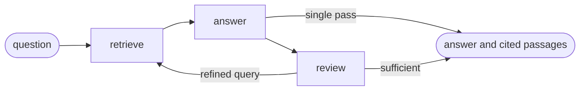

# Agentic Research Assistant

Answers questions about research papers and cites the passages it used. It retrieves passages, drafts an answer, and has a second model call review that answer against the passages it cites. When the review finds the answer unsupported or incomplete, it writes a new search query and the loop goes around again, up to three rounds.

What I wanted to know is whether the review loop is worth it. Every extra round costs model calls and seconds, so this repo measures the loop against a single pass (retrieve once, answer once) on QASPER: the dataset's official answer F1 and evidence F1, a model judge checked against 40 labels, and the dollars and seconds each system spends per question.

The loop does not earn its extra calls. Against a single pass that stops at the first search's top 5 passages it ties (the loop starts from that same retrieval but can search again, and averages 5.6 passages a question): on the 150 test questions it is judged correct 58.7% of the time against 56.0%, within noise, at 2.5 model calls a question instead of 1. Against a single pass that reads 10 or 15 passages in one call, the loop loses on both splits: 68.0% against 58.7% on test, and 58.0% and 64.0% against 50.7% on dev, at about a fifth of the loop's 95th-percentile latency.

## How a question is answered



1. Retrieve. The query is embedded with all-MiniLM-L6-v2, run through ONNX Runtime with the weights checked against their SHA-256, and the top 5 passages come from an exact cosine search over a numpy matrix. A paper is a few hundred passages, so the exact search takes milliseconds and an approximate index would only cost recall.
2. Answer. The passages go to the model numbered [1] to [5], and the reply has to match a JSON schema: a short answer, the numbers of the passages that support it, and a flag for "the passages don't answer this". Passage numbers the model makes up are dropped.
3. Review. A second call gets the question, the answer and the full text of the passages it cites, or of every passage it had when it declined. It says whether each part of the answer is supported and whether it answers the question, and if not, names what's missing and writes one search query to find it.
4. That query retrieves again, new passages are merged with the ones already found, and the answer is redone from all of them.

A run ends one of five ways, and the result says which:

| Status | When |
|---|---|
| answered | the review accepted the answer, or found it lacking without a query to try; it's also how a single pass ends |
| round cap | three rounds done |
| no new passages | the refined query found only passages the last answer already had, so answering again would repeat it |
| deadline | 120 seconds passed, checked before every model call |
| budget | the next call could take spending past the cap, checked before every call |

Model calls go through one small interface, `LLMClient`. OpenAI's Responses API is the default; another provider is one more class with a `complete` method. Retries on timeouts, rate limits and 5xx responses happen in my code rather than inside the SDK, so each retry shows up in the trace and the tests can count them. Every reply records the model ID the API reports, the tokens, the cost and the wall time, and every run carries a trace with each step's seconds and calls.

## How the loop is measured

QASPER ([Dasigi et al., NAACL 2021](https://aclanthology.org/2021.naacl-main.365)) has 5,049 questions about 1,585 NLP papers. Annotators answered each question after reading the whole paper and marked the paragraphs their answer rests on, so a system is scored on what it cites as well as what it says. Some questions can't be answered from the paper, which tests whether a system declines instead of guessing.

- Each question is asked against its own paper, split into its paragraphs exactly as the dataset has them, so a cited paragraph matches the annotators' evidence character for character.
- 150 questions are drawn with seed 0 from the dev split (1,005 questions on 281 papers) and 150 from the test split (1,451 on 416). Dev is for reading errors and changing things. Test runs once, after the last change.
- Both systems use the same retrieval and the same models: gpt-6-luna answers and reviews with low reasoning effort, and gpt-6.1-sol grades. The loop's first round sends exactly the single pass's request, so its first answer is the single pass's answer, replayed rather than paid for twice, and any difference between the two comes from the review rounds.
- Answer F1 and evidence F1 are the official metrics, ported from the evaluator in [allenai/qasper-led-baseline](https://github.com/allenai/qasper-led-baseline) (`scripts/evaluator.py` at `afd0fb9`): token F1 against each annotator, keeping the best, and evidence over text paragraphs only, since this system can't retrieve a figure or a table.
- Token F1 scores a right answer low when it's worded differently from every annotator, so a judge model also grades each answer correct or incorrect against the annotators' answers. Exact matches skip the judge.
- I graded 40 of the judged test answers myself, by hand and without seeing the judge's verdicts, and the results report how often the judge agrees with me and Cohen's kappa. The sheet is 40 answers over 37 distinct questions from one grader in one pass (`results/qasper/LABELS.md`). An earlier draft of the labels, which was not an independent grade, is kept in `results/qasper/labels.csv` and is not scored.
- Differences between the systems are paired by question, with 95% intervals from 10,000 bootstrap resamples.
- Each wrong answer gets the first stage that failed: evidence not retrieved, retrieved but not cited, cited but answered wrong, declined an answerable question, or answered an unanswerable one.
- Spending is capped across everything recorded, at $25 by default (`--cap`). The recorded QASPER runs passed `--cap 5`, so their ceiling was $5. Before each call the client prices the worst case, counting the prompt at a deliberately high one token per three characters plus the full output allowance, and refuses a call that could cross the cap.

## Results

The single pass and the loop ran on 2026-10-28 at commit `daac2a1`. The two matched single passes (the top 10 and the top 15 passages of the first search) ran on 2026-11-02 at `aac699e`; the loop and single-pass rows replayed from the recording, so only the new answers hit the API. Seed 0, 150 dev and 150 test questions. The full tables, with intervals, are in [`results/RESULTS.md`](results/RESULTS.md), and `make check-replay` reproduces every row with no key. Counting every recorded call, the original runs and the matched ones, the recording comes to $0.89 of a $5 cap across 1,986 calls. The spend line in `RESULTS.md` is a running total over everything recorded up to the end of that run, so the dev file's $0.65 is the total when the matched dev run finished, not what dev cost.

| Split | System | Answer F1 | Evidence F1 | Judged correct | Calls per question | Passages per question | p95 seconds |
|---|---|---|---|---|---|---|---|
| dev | single pass | 0.337 | 0.447 | 49.3% | 1.0 | 5.0 | 2.9 |
| dev | loop | 0.349 | 0.455 | 50.7% | 2.5 | 5.6 | 10.8 |
| dev | single pass, top 10 | 0.414 | 0.518 | 58.0% | 1.0 | 10.0 | 2.2 |
| dev | single pass, top 15 | 0.419 | 0.559 | 64.0% | 1.0 | 14.9 | 2.1 |
| test | single pass | 0.435 | 0.563 | 56.0% | 1.0 | 5.0 | 2.2 |
| test | loop | 0.441 | 0.587 | 58.7% | 2.5 | 5.6 | 11.0 |
| test | single pass, top 10 | 0.473 | 0.590 | 68.0% | 1.0 | 10.0 | 2.2 |
| test | single pass, top 15 | 0.475 | 0.582 | 68.0% | 1.0 | 15.0 | 2.3 |

The loop scores a little higher on every measure and the difference is within noise. Paired by question, the 95% interval on the answer F1 difference is -0.011 to +0.037 on dev and -0.015 to +0.029 on test. Evidence F1 on test is +0.024 (-0.003 to +0.051), and judged accuracy on test is +2.7 points (0.000 to +0.060), which is 5 questions where the loop was right and the single pass wrong against 1 the other way. With six comparisons, I don't read any of those as a finding. The loop ran 2.5 calls per question against 1, answering cost about three times as much per question ($0.00028 against $0.00009 on test), and the slowest 5% of questions took about 11 seconds against 2 to 3. Counting judging, the dollars per question differ by about 20% ($0.0011 against $0.0009), because judging dominates the bill. On this sample I can't say the loop is worth its extra calls.

## A fairer baseline: spending the loop's budget on retrieval

The loop answers from up to three searches of 5 passages, so on some questions it reads up to 15 passages while the single pass reads 5. The comparison above doesn't separate "the review helped" from "it saw more text". `--matched` adds two single-pass baselines that make one answer call over the top 10 or the top 15 passages of the first search, and pairs each against the loop by question with the same bootstrap.

```
make eval-matched   # replays the loop and single-pass rows from the recording; only the 2 x 150 new answers (and their judge calls) hit the API
```

These baselines are matched to the most the loop can read, not to what it reads on average. The loop averages 5.6 passages a question, so at 10 and 15 the baselines read more than it does. The honest reading is that they test a different question from "the same context": the single pass and the loop share the first search's top 5 passages, but the loop can search again. Given the loop's retrieval budget, is it better spent on a review loop or on a wider first search?

On this sample the wider search wins. Judged correct, loop minus baseline, paired by question:

| Split | Baseline | Difference | 95% CI | Loop right, baseline wrong | Baseline right, loop wrong | Sign-test p |
|---|---|---|---|---|---|---|
| dev | top 10 | -7.3 points | -13.3 to -1.3 | 5 | 16 | 0.027 |
| dev | top 15 | -13.3 points | -20.0 to -7.3 | 3 | 23 | < 0.001 |
| test | top 10 | -9.3 points | -16.7 to -2.0 | 9 | 23 | 0.020 |
| test | top 15 | -9.3 points | -16.7 to -2.0 | 10 | 24 | 0.024 |

Answer F1 points the same way, by 0.03 to 0.07, with intervals that exclude zero on dev and include it on test. Evidence F1 is mixed: -0.06 and -0.10 on dev, about zero on test. A single pass at 10 or 15 passages costs about the same per question as the loop ($0.0010 and $0.0011 on test, judging included) and its 95th-percentile latency is 2.2 seconds against 11.0.

The failure table fits a retrieval-limited problem. On test the loop never retrieved the evidence on 20 of 150 questions and declined 23 answerable ones, against 11 and 16 for the top-10 baseline and 8 and 12 for the top-15 one. I haven't tested that explanation, and I haven't tried a stronger first retrieval for the loop either, so this does not show that a review loop can't help, only that this one, with this retriever, didn't.

The matched baselines were designed before this run but added after I had seen the original test results, so the test comparison is post hoc. The dev comparison, run once with the same code, points the same way.

## Rerunning the numbers without a key

Every model reply is recorded under a hash of its request in `results/qasper/calls.jsonl`, and every search and how each run stopped go to `results/qasper/runs.jsonl`. `research-assistant check-replay results/qasper-test.json` reruns the evaluation from those files with no API key and lists every answer, citation or score that comes out different. CI does this on every push once a recording is committed.

The search log is there because MiniLM runs in float32. On another CPU a similarity can move in the sixth decimal place, which is enough to swap two nearly tied paragraphs, change the prompt and miss the recorded reply. A replay recomputes each search and keeps the logged ranking when every score agrees to within 1e-4. A bigger difference means retrieval itself changed, and the replay fails instead of answering from different passages.

`research-assistant carry-timings` puts the wall times measured in an earlier results file back on rows a replay has just reproduced, since a replay doesn't wait on the API and would otherwise record near-zero seconds.

The replay doubles as a regression test: change a prompt, the top-k or the chunking and it fails, because the model would be asked something it wasn't. The unit tests replay recorded stub responses through the real graph, offline.

## Running it

Python 3.12 or newer.

```bash
git clone https://github.com/bharathkumardev1/Agentic-Research-Assistant.git
cd Agentic-Research-Assistant
python -m venv .venv && source .venv/bin/activate
make install   # the hashed lock, then the package and the test tools
make demo      # three sample papers, offline stub model, no key
```

The three papers in `examples/sample_papers` are short synthetic papers I wrote so the demo runs offline. The demo's answers say nothing about real research.

For your own papers, put an OpenAI key in `.env` (copy `.env.example`):

```bash
research-assistant ingest path/to/papers/                     # PDF, text or Markdown
research-assistant ingest --arxiv "retrieval augmented generation" --arxiv-max 8
research-assistant research "Which datasets do these papers evaluate on?"
research-assistant research "..." --max-rounds 1              # single pass
research-assistant research "..." --json                      # everything, trace included
```

The QASPER evaluation calls the API, and the cap stops it at $25 unless you pass `--cap`. The recorded runs used `--cap 5`:

```bash
make qasper      # dev and test sets, with the release tarballs' SHA-256 recorded
make eval-dev    # 150 dev questions through both systems
make eval-test   # 150 test questions, once
make labels      # 40 judged answers to grade, in results/qasper/labels-independent.csv; refuses to overwrite an existing sheet
make agreement   # the judge against your grades, written into the results
make check-replay
```

It runs one question at a time and prints a line per answer. An interrupted run picks up where it stopped: recorded replies replay for free and only the missing calls are made.

### API

```bash
uvicorn research_assistant.webapp:app
curl -X POST localhost:8000/research -H 'Content-Type: application/json' \
  -d '{"question": "Which datasets do these papers evaluate on?"}'
```

`POST /research` returns the answer, the cited passages, the reviews and the trace. `GET /health` says whether answers come from the model or the offline stub, `GET /metrics` serves Prometheus counters and a latency histogram, and `/docs` is the generated API page. Setting `WEB_API_KEY`, or `WEB_API_KEYS` as `name:key` pairs, makes `/research` require an `X-API-Key` header. `RATE_LIMIT_PER_MINUTE` limits each caller, in memory and per process, so with several workers each one counts separately. `REQUEST_TIMEOUT_SECONDS` turns a slow run into a 504, and a failed run returns a short reference id while the traceback goes to the log under the same id.

```bash
docker build -t research-assistant .
docker run --rm -p 8000:8000 research-assistant
```

With no key and nothing mounted, the image serves the sample papers with the offline stub, which is what CI's smoke test runs. The Dockerfile's header has the command for real answers with mounted weights and an index. The base image is pinned by digest and dependencies install from `requirements.lock` with hashes.

## Configuration

Environment variables or `.env`:

| Variable | Default | |
|---|---|---|
| `OPENAI_API_KEY` | | needed for real answers and the evaluation |
| `ANSWER_MODEL`, `REVIEW_MODEL` | `gpt-6-luna` | |
| `JUDGE_MODEL` | `gpt-6.1-sol` | grades answers in the evaluation |
| `REASONING_EFFORT` | `low` | |
| `TOP_K` | `5` | passages per search |
| `MAX_ROUNDS` | `3` | 1 is the single pass |
| `RUN_DEADLINE_SECONDS` | `120` | checked before every model call |
| `RUN_BUDGET_USD` | `0.50` | spending cap for one `research` question; the evaluation uses `--cap` |
| `CALL_TIMEOUT_SECONDS`, `CALL_ATTEMPTS` | `60`, `3` | per attempt; retries on timeouts, 429 and 5xx |
| `EMBEDDING_BACKEND` | `minilm` | or `hashing`, which needs no download |
| `INDEX_DIR` | `data/index` | |

The web service's settings are in `.env.example`.

## Limits

- QASPER papers are all NLP, and the evaluation searches each question's own paper. With many papers in one index, which `research` allows, retrieval has more ways to go wrong than this measures.
- Figures and tables aren't indexed. Questions whose evidence is a table are scored on text evidence only and are harder to answer.
- With 150 test questions, the 95% interval on judged accuracy is 8 points either side, so a small difference between the systems will show up as a tie, and it did.
- The judge is a model. I checked it against 40 of my own grades: 87.5% agreement, Cohen's kappa 0.75, the judge more lenient than me on 2 answers and stricter on 3. That is one grader, 37 distinct questions, and a sample that includes the matched baselines, so it shows the judge is broadly in line with me. It does not settle how much to trust a difference of a few points.
- One seed, one sample of 150 questions per split, one model pair and one embedding model.
- Prices in `llm.py` are copied from OpenAI's pricing page on 2026-10-21. If they change, the recorded dollars go stale and `check-replay` flags it.

## Layout

```
src/research_assistant/
  graph/workflow.py   the loop as a LangGraph graph, and how a run stops
  agents/             retrieve, answer, review
  llm.py              the client interface, OpenAI client, offline stub, recorder, budget, retries
  trace.py            per-step seconds, tokens and cost
  rag/                MiniLM through ONNX Runtime, exact numpy search
  ingestion/          PDF, text and arXiv loaders, chunking
  eval/               QASPER loader and metrics, the evaluation, run log, replay export
  webapp.py           the HTTP API
  cli.py              the research-assistant command
```

## History

I started this in July 2026 as a LangGraph demo on a different model provider's API (tag `v0.2.0`) and rebuilt it in October around the QASPER evaluation. The July commits came over from an earlier repository with their author name and email changed and are unsigned. On 28 October 2026 I re-signed the history after them; the earlier history is at tag `backup/pre-sign-20261028T152119Z`.

## License

MIT, see [LICENSE](LICENSE).
