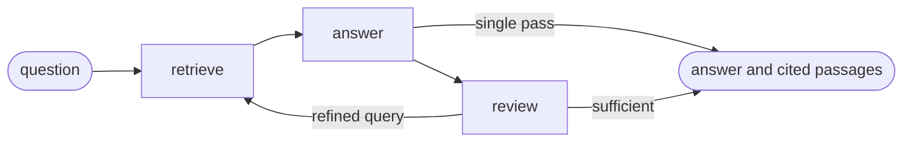

# Agentic Research Assistant

Answers questions about research papers and cites the passages it used. It retrieves passages, drafts an answer, and has a second model call review that answer against the passages it cites. When the review finds the answer unsupported or incomplete, it writes a new search query and the loop goes around again, up to three rounds.

What I wanted to know is whether the review loop is worth it. Every extra round costs model calls and seconds, so this repo measures the loop against a single pass (retrieve once, answer once) on QASPER: the dataset's official answer F1 and evidence F1, a model judge that I check against my own grades, and the dollars and seconds each system spends per question.

## How a question is answered



1. Retrieve. The query is embedded with all-MiniLM-L6-v2, run through ONNX Runtime with the weights checked against their SHA-256, and the top 5 passages come from an exact cosine search over a numpy matrix. A paper is a few hundred passages, so the exact search takes milliseconds and an approximate index would only cost recall.
2. Answer. The passages go to the model numbered [1] to [5], and the reply has to match a JSON schema: a short answer, the numbers of the passages that support it, and a flag for "the passages don't answer this". Passage numbers the model makes up are dropped.
3. Review. A second call gets the question, the answer and the full text of the passages it cites, or of every passage it had when it declined. It says whether each part of the answer is supported and whether it answers the question, and if not, names what's missing and writes one search query to find it.
4. That query retrieves again, new passages are merged with the ones already found, and the answer is redone from all of them.

A run ends one of five ways, and the result says which:

| Status | When |
|---|---|
| answered | the review accepted the answer, or found it lacking without a query to try; it's also how a single pass ends |
| round cap | three rounds done |
| no new passages | the refined query found only passages the last answer already had, so answering again would repeat it |
| deadline | 120 seconds passed, checked before every model call |
| budget | the next call could take spending past the cap, checked before every call |

Model calls go through one small interface, `LLMClient`. OpenAI's Responses API is the default; another provider is one more class with a `complete` method. Retries on timeouts, rate limits and 5xx responses happen in my code rather than inside the SDK, so each retry shows up in the trace and the tests can count them. Every reply records the model ID the API reports, the tokens, the cost and the wall time, and every run carries a trace with each step's seconds and calls.

## How the loop is measured

QASPER ([Dasigi et al., NAACL 2021](https://aclanthology.org/2021.naacl-main.365)) has 5,049 questions about 1,585 NLP papers. Annotators answered each question after reading the whole paper and marked the paragraphs their answer rests on, so a system is scored on what it cites as well as what it says. Some questions can't be answered from the paper, which tests whether a system declines instead of guessing.

- Each question is asked against its own paper, split into its paragraphs exactly as the dataset has them, so a cited paragraph matches the annotators' evidence character for character.
- 150 questions are drawn with seed 0 from the dev split (1,005 questions on 281 papers) and 150 from the test split (1,451 on 416). Dev is for reading errors and changing things. Test runs once, after the last change.
- Both systems use the same retrieval and the same models: gpt-6-luna answers and reviews with low reasoning effort, and gpt-6.1-sol grades. The loop's first round sends exactly the single pass's request, so its first answer is the single pass's answer, replayed rather than paid for twice, and any difference between the two comes from the review rounds.
- Answer F1 and evidence F1 are the official metrics, ported from the evaluator in [allenai/qasper-led-baseline](https://github.com/allenai/qasper-led-baseline) (`scripts/evaluator.py` at `afd0fb9`): token F1 against each annotator, keeping the best, and evidence over text paragraphs only, since this system can't retrieve a figure or a table.
- Token F1 scores a right answer low when it's worded differently from every annotator, so a judge model also grades each answer correct or incorrect against the annotators' answers. Exact matches skip the judge.
- I grade 40 of the judged test answers myself without seeing the judge's verdicts, and the results report how often we agree and Cohen's kappa.
- Differences between the systems are paired by question, with 95% intervals from 10,000 bootstrap resamples.
- Each wrong answer gets the first stage that failed: evidence not retrieved, retrieved but not cited, cited but answered wrong, declined an answerable question, or answered an unanswerable one.
- Spending is capped at $25 across everything recorded. Before each call the client prices the worst case, counting the prompt at a deliberately high one token per three characters plus the full output allowance, and refuses a call that could cross the cap.

## Rerunning the numbers without a key

Every model reply is recorded under a hash of its request in `results/qasper/calls.jsonl`, and every search and how each run stopped go to `results/qasper/runs.jsonl`. `research-assistant check-replay results/qasper-test.json` reruns the evaluation from those files with no API key and lists every answer, citation or score that comes out different. CI does this on every push once a recording is committed.

The search log is there because MiniLM runs in float32. On another CPU a similarity can move in the sixth decimal place, which is enough to swap two nearly tied paragraphs, change the prompt and miss the recorded reply. A replay recomputes each search and keeps the logged ranking when every score agrees to within 1e-4. A bigger difference means retrieval itself changed, and the replay fails instead of answering from different passages.

The replay doubles as a regression test: change a prompt, the top-k or the chunking and it fails, because the model would be asked something it wasn't. The unit tests replay recorded stub responses through the real graph, offline.

## Running it

Python 3.12 or newer.

```bash
git clone https://github.com/bharathkumardev1/Agentic-Research-Assistant.git
cd Agentic-Research-Assistant
python -m venv .venv && source .venv/bin/activate
make install   # the hashed lock, then the package and the test tools
make demo      # three sample papers, offline stub model, no key
```

The three papers in `examples/sample_papers` are short synthetic papers I wrote so the demo runs offline. The demo's answers say nothing about real research.

For your own papers, put an OpenAI key in `.env` (copy `.env.example`):

```bash
research-assistant ingest path/to/papers/                     # PDF, text or Markdown
research-assistant ingest --arxiv "retrieval augmented generation" --arxiv-max 8
research-assistant research "Which datasets do these papers evaluate on?"
research-assistant research "..." --max-rounds 1              # single pass
research-assistant research "..." --json                      # everything, trace included
```

The QASPER evaluation calls the API, and the cap stops it at $25:

```bash
make qasper      # dev and test sets, with the release tarballs' SHA-256 recorded
make eval-dev    # 150 dev questions through both systems
make eval-test   # 150 test questions, once
make labels      # 40 judged answers for you to grade, in results/qasper/labels.csv
make agreement   # the judge against your grades, written into the results
make check-replay
```

It runs one question at a time and prints a line per answer. An interrupted run picks up where it stopped: recorded replies replay for free and only the missing calls are made.

### API

```bash
uvicorn research_assistant.webapp:app
curl -X POST localhost:8000/research -H 'Content-Type: application/json' \
  -d '{"question": "Which datasets do these papers evaluate on?"}'
```

`POST /research` returns the answer, the cited passages, the reviews and the trace. `GET /health` says whether answers come from the model or the offline stub, `GET /metrics` serves Prometheus counters and a latency histogram, and `/docs` is the generated API page. Setting `WEB_API_KEY`, or `WEB_API_KEYS` as `name:key` pairs, makes `/research` require an `X-API-Key` header. `RATE_LIMIT_PER_MINUTE` limits each caller, in memory and per process, so with several workers each one counts separately. `REQUEST_TIMEOUT_SECONDS` turns a slow run into a 504, and a failed run returns a short reference id while the traceback goes to the log under the same id.

```bash
docker build -t research-assistant .
docker run --rm -p 8000:8000 research-assistant
```

With no key and nothing mounted, the image serves the sample papers with the offline stub, which is what CI's smoke test runs. The Dockerfile's header has the command for real answers with mounted weights and an index. The base image is pinned by digest and dependencies install from `requirements.lock` with hashes.

## Configuration

Environment variables or `.env`:

| Variable | Default | |
|---|---|---|
| `OPENAI_API_KEY` | | needed for real answers and the evaluation |
| `ANSWER_MODEL`, `REVIEW_MODEL` | `gpt-6-luna` | |
| `JUDGE_MODEL` | `gpt-6.1-sol` | grades answers in the evaluation |
| `REASONING_EFFORT` | `low` | |
| `TOP_K` | `5` | passages per search |
| `MAX_ROUNDS` | `3` | 1 is the single pass |
| `RUN_DEADLINE_SECONDS` | `120` | checked before every model call |
| `RUN_BUDGET_USD` | `0.50` | spending cap for one `research` question; the evaluation uses `--cap` |
| `CALL_TIMEOUT_SECONDS`, `CALL_ATTEMPTS` | `60`, `3` | per attempt; retries on timeouts, 429 and 5xx |
| `EMBEDDING_BACKEND` | `minilm` | or `hashing`, which needs no download |
| `INDEX_DIR` | `data/index` | |

The web service's settings are in `.env.example`.

## Limits

- QASPER papers are all NLP, and the evaluation searches each question's own paper. With many papers in one index, which `research` allows, retrieval has more ways to go wrong than this measures.
- Figures and tables aren't indexed. Questions whose evidence is a table are scored on text evidence only and are harder to answer.
- With 150 test questions, the 95% interval on judged accuracy is 7 to 8 points either side, so a small difference between the systems will show up as a tie.
- The judge is a model. Forty hand-graded answers say how far to trust it, not that it's right on the rest.
- Prices in `llm.py` are copied from OpenAI's pricing page on 2026-10-21. If they change, the recorded dollars go stale and `check-replay` flags it.

## Layout

```
src/research_assistant/
  graph/workflow.py   the loop as a LangGraph graph, and how a run stops
  agents/             retrieve, answer, review
  llm.py              the client interface, OpenAI client, offline stub, recorder, budget, retries
  trace.py            per-step seconds, tokens and cost
  rag/                MiniLM through ONNX Runtime, exact numpy search
  ingestion/          PDF, text and arXiv loaders, chunking
  eval/               QASPER loader and metrics, the evaluation, run log, replay export
  webapp.py           the HTTP API
  cli.py              the research-assistant command
```

## License

MIT, see [LICENSE](LICENSE).
