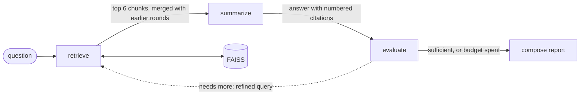

# agentic-research-assistant

Answers a question about a set of papers with a numbered citation on every claim, and
checks its own answer before returning it. A retriever, a summarizer and an evaluator run
in a LangGraph loop over one FAISS index. When the evaluator finds claims the cited
passages don't support, or parts of the question left unanswered, it writes a sharper
query and the loop runs again: at most 3 rounds and 40 model calls per question, so a
critic that is never satisfied can't run up a bill.

What's measured here is the engineering. There is no answer-quality evaluation yet, so I
can't claim the loop beats a single retrieve-and-summarize pass; the plan for measuring
that is at the bottom. The tests include a full run of the real graph against a stub
model, and the FastAPI service has auth, per-caller rate limits, timeouts and Prometheus
metrics.

```bash
pip install -e .
python -m research_assistant demo    # offline: hashing embedder and a stub model, no API key
```

The demo indexes three short sample papers in `examples/sample_papers/`, which I wrote so
there is something to run on. Their numbers are invented. With `ANTHROPIC_API_KEY` set
(copy `.env.example` to `.env`), the same commands call Claude.

## How it works



1. Papers (PDF, text, Markdown or arXiv search results) are split on paragraph, then
   sentence, then word boundaries into 1,100-character chunks with 150 of overlap,
   embedded with all-MiniLM-L6-v2, and stored in a flat FAISS inner-product index.
2. The retriever takes the top 6 chunks for the current query and merges them with what
   earlier rounds found, keeping each chunk's best score.
3. The summarizer gets the chunks numbered `[1]..[n]` and must answer from them only, as
   JSON (summary, methods, findings, gaps) that Pydantic validates. The numbering and the
   bibliography come from one function, so a `[3]` in the text is always the third entry
   in the reference list.
4. The evaluator, a second model call, reads the answer next to the same numbered
   passages and returns whether it's grounded, a coverage score, and a refined query if
   more evidence would help.
5. The loop stops when the evaluator is satisfied, gives no better query, or the round or
   call budget runs out. The result is a Markdown report with the search trail.

## Decisions

| Decision | Why | What it costs |
|---|---|---|
| A separate evaluator call that can send the graph back to retrieval | One pass answers from whatever the first query found. A critic that names the missing piece turns that into a second, targeted search. | Up to 3x the model calls per question, and the loop is only worth it if a measurement shows it is (not done yet). |
| Hard caps on rounds (3) and model calls (40) | Agent loops fail by never stopping. The call cap lives in the API client, so no graph bug can get around it. | A question that still needs more after round 3 gets the round-3 answer, with the evaluator's verdict in the report. Hitting the call cap stops the run with an error. |
| The evaluator sees the full cited passages | It used to check claims against 180-character previews, so evidence further into a passage looked missing. | At round 3 an evaluation reads up to about 20,000 characters of passages instead of 3,200. |
| Model output is JSON validated by Pydantic | A malformed answer fails at the boundary instead of rendering a report with broken citations. | A malformed answer fails the run; nothing repairs or re-asks yet. |
| An offline mode: hashing embedder and a stub model | CI and a first-time reader can run the whole graph without a key or a model download. | The stub's answers mean nothing; it only exercises the code paths. |
| Rate limits and caching in memory, per process | One instance is all this needs. | They don't coordinate across workers or replicas; `rate_limit.py` notes what a shared limiter would take. |

## Use it on your own papers

```bash
research-assistant ingest path/to/papers/                     # .pdf, .txt, .md
research-assistant ingest --arxiv "retrieval augmented generation" --arxiv-max 8
research-assistant research "What methods do these papers use for grounding, and what gaps remain?" -o report.md
```

## Service

```bash
uvicorn research_assistant.webapp:app      # or: docker build -t research-assistant . && docker run -p 8000:8000 research-assistant
curl -X POST localhost:8000/research -H "Content-Type: application/json" \
  -d '{"question": "What are the research gaps?"}'
```

- `POST /research` runs the loop for one question. It's open unless `WEB_API_KEY` (one
  key) or `WEB_API_KEYS` (`name:key` pairs) is set, then it needs `X-API-Key`.
- Each caller gets `RATE_LIMIT_PER_MINUTE` requests (default 20), keyed by key name or IP.
  A run longer than `REQUEST_TIMEOUT_SECONDS` (default 120) returns 504.
- A failed run returns a generic error with a short reference id; the exception is logged
  under the same id, so nothing internal leaks to the caller.
- `GET /health` reports live or offline mode; `GET /metrics` exports request counts by
  outcome and a latency histogram for Prometheus.

`render.yaml` deploys the Docker image to Render. Set `ANTHROPIC_API_KEY` and `WEB_API_KEY`
as secrets there, and mount a volume at `INDEX_DIR` so an ingested index survives
restarts.

The models default to `claude-sonnet-4-6` for the summarizer and `claude-opus-4-8` for the
evaluator (`SUMMARIZER_MODEL`, `EVALUATOR_MODEL`). Every setting is an environment
variable; [`config.py`](src/research_assistant/config.py) lists them with their defaults.

`frontend/` is a small Vite and React page: question box, the three stages as they run,
and the answer with clickable citations next to their passages. It runs on built-in demo
data unless `VITE_API_URL` points it at the service.

## Tests and CI

`pytest` runs 59 tests: chunk boundaries, citation numbering and alignment, schema
validation, JSON extraction from model output, the hashing embedder, FAISS save and load,
the call budget, the evaluator's evidence, a full offline run through the LangGraph loop,
and the service's auth, rate limits, timeouts, error handling and metrics. CI runs ruff,
mypy and the tests on Python 3.9, 3.11 and 3.12. A manual workflow runs one real question
against the API when an `ANTHROPIC_API_KEY` repository secret is set.

## What's still rough

- No answer-quality numbers, which is the main gap.
- The evaluator is the same family of model as the summarizer, grading its work. A
  stronger check would verify each cited sentence against its passage with a separate
  entailment model.
- `anthropic` is pinned below 1.0, which dropped `temperature` from `messages.create`.
- One process, an index in a file, no accounts. Tracing is structured logs with a run id.

## How I'd measure it

QASPER (Dasigi et al., 2021) has 5,049 questions over 1,585 NLP papers, answered by NLP
practitioners who also mark the evidence for each answer. That gives three
numbers, each against a single pass with the same retriever and summarizer:

1. Evidence recall: the share of annotated evidence paragraphs among the chunks the
   answer cites.
2. Answer F1 against the annotated answers, the dataset's own metric.
3. Rounds and model calls per question, and what they cost.

The loop earns its place only if it raises the first two by more than their bootstrap
noise at a cost per question someone would pay.

## Layout

```
src/research_assistant/
  ingestion/    loaders (PDF, text, Markdown, arXiv) and the chunker
  rag/          embeddings and the FAISS store
  agents/       retriever, summarizer, evaluator
  graph/        the LangGraph loop and its state
  context.py    numbering chunks into citations
  llm.py        Claude client with retries and the call budget, plus the offline stub
  webapp.py     FastAPI service; rate_limit.py, logging_utils.py
  cli.py        the research-assistant command
```

## License

MIT
