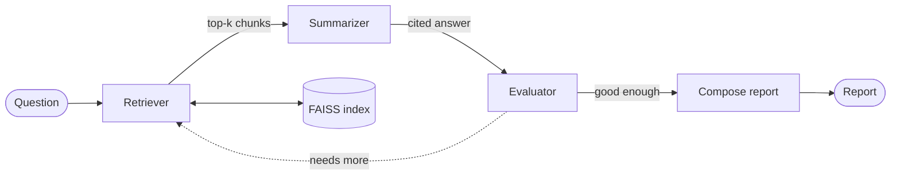

# Agentic Research Assistant

[](https://github.com/bharathkumardev1/Agentic-Research-Assistant/actions/workflows/ci.yml)


Answers questions about a set of research papers, with a citation on every claim. Three agents
share one FAISS index: a retriever pulls passages, a summarizer writes an answer from those
passages only, and an evaluator grades the answer and sends a sharper query back if it's thin.
LangGraph runs the loop. The model is Claude.

**Live API:** https://agentic-research-assistant-xzno.onrender.com/docs (free host, so the
first request after it's been idle takes 30 to 60 seconds)

## Quick start

No API key needed. The demo runs fully offline:

```bash
git clone https://github.com/bharathkumardev1/Agentic-Research-Assistant.git
cd Agentic-Research-Assistant
pip install -e .
python -m research_assistant demo
```

```
Indexed 3 sample paper(s) into 7 chunk(s)  (backend: hashing)
Mode: OFFLINE dry-run (stub model)

→ retrieve  query='How do retrieval-augmented and multi-agent approaches improve the
reliability of LLM-generated scientific answers, and what gaps remain?'
  found 6 new chunk(s); 6 in context
→ summarize  over 6 chunk(s)
→ evaluate  iter=1 verdict=needs_more coverage=0.55
→ retrieve  query='quantitative results and limitations'
  found 6 new chunk(s); 7 in context
→ summarize  over 7 chunk(s)
→ evaluate  iter=2 verdict=sufficient coverage=0.85
✓ composing report
```

Offline mode swaps in a hashing embedder and a stub model that fakes structured output from
the retrieved text. Retrieval, the graph, citation numbering, and the report renderer are the
real code paths. Put `ANTHROPIC_API_KEY` in `.env` (copy `.env.example`) to get real answers.

The three sample papers in `examples/sample_papers/` are synthetic. I wrote them so the demo has
something to run on, so the numbers in the sample report don't come from real research.

## How the loop works



1. Papers are split on paragraph, then sentence, then word boundaries (1,100 characters with
   150 overlap by default), embedded, and added to FAISS.
2. The retriever returns the top matches by cosine similarity and merges them with what earlier
   loops already found.
3. The summarizer gets the numbered chunks, answers from them only, and tags each claim with
   `[n]`. The JSON it returns is validated with Pydantic.
4. The evaluator is a second Claude call that scores grounding and coverage. If the answer needs
   more and there's budget left, it writes a new query and the graph loops.
5. When the evaluator is satisfied or the budget runs out, the result is rendered as a Markdown
   report: summary, methods, findings, gaps, the search trail, and a numbered reference list.

The loop stops after `MAX_ITERATIONS` (3) and a run can make at most `MAX_API_CALLS` (40) model
calls, so an evaluator that never says "good enough" can't loop forever or run up a bill.

## Your own papers

```bash
research-assistant ingest path/to/papers/                     # .pdf, .txt, .md
research-assistant ingest --arxiv "retrieval augmented generation" --arxiv-max 8

research-assistant research "What methods do these papers use for grounding, and what gaps remain?"
research-assistant research "Compare their evaluation setups" -o report.md
research-assistant research "Compare their evaluation setups" --json
```

## API

```bash
uvicorn research_assistant.webapp:app --reload
```

| Endpoint | Auth | |
|---|---|---|
| `GET /health` | none | status, and whether it's in live or offline mode |
| `GET /metrics` | none | Prometheus metrics: requests by outcome, latency histogram |
| `POST /research` | `X-API-Key` if configured | runs the loop for one question |
| `GET /docs` | none | Swagger UI |

```bash
curl -X POST http://localhost:8000/research \
  -H "Content-Type: application/json" \
  -H "X-API-Key: your-key" \
  -d '{"question": "What are the research gaps?"}'
```

`/research` is open unless `WEB_API_KEY` (one shared key) or `WEB_API_KEYS` (`name:key` pairs) is
set. Each caller gets `RATE_LIMIT_PER_MINUTE` requests, keyed by API key name or IP, and a request
that runs past `REQUEST_TIMEOUT_SECONDS` gets a 504. A failed run returns a generic error with a
short reference id; the full exception is logged server-side under the same id.

## Config

Everything comes from environment variables or `.env`:

| Variable | Default | |
|---|---|---|
| `ANTHROPIC_API_KEY` | | needed for real answers, not for the demo |
| `SUMMARIZER_MODEL` | `claude-sonnet-4-6` | model that writes the answer |
| `EVALUATOR_MODEL` | `claude-opus-4-8` | model that grades it |
| `MAX_ITERATIONS` | `3` | retrieve/summarize/evaluate cycles |
| `MAX_API_CALLS` | `40` | hard cap on model calls per run |
| `TOP_K` | `6` | chunks per query |
| `CHUNK_SIZE` / `CHUNK_OVERLAP` | `1100` / `150` | characters |
| `EMBEDDING_BACKEND` | `sentence-transformers` | or `hashing` for the offline embedder |
| `EMBEDDING_MODEL` | `sentence-transformers/all-MiniLM-L6-v2` | |
| `WEB_API_KEY` / `WEB_API_KEYS` | | turn on auth for `/research` |
| `RATE_LIMIT_PER_MINUTE` | `20` | per caller; `0` turns it off |
| `REQUEST_TIMEOUT_SECONDS` | `120` | |
| `CORS_ORIGINS` | `*` | |
| `INDEX_DIR` | `data/index` | where an ingested index is saved and loaded |
| `LOG_LEVEL` | `INFO` | |

## Deploy

```bash
docker build -t research-assistant .
docker run --rm -p 8000:8000 research-assistant
```

The live demo is this image on Render's free tier, deployed from `render.yaml`. Set
`ANTHROPIC_API_KEY` and `WEB_API_KEY` as secrets in the Render dashboard.

Some things that matter on Render:

- Mount a persistent volume at `INDEX_DIR` and run `research-assistant ingest` once, or the
  service rebuilds the demo index on every restart.
- `WEB_CONCURRENCY` sets the number of uvicorn workers. Each worker holds its own copy of the
  index and its own rate limiter, so the effective limit is `RATE_LIMIT_PER_MINUTE` times the
  worker count. The free plan has one CPU, so it's 1.
- `.github/workflows/keepalive.yml` pings `/health` every 10 minutes so the free instance doesn't
  go to sleep. Render still caps free monthly hours, so this only helps so much.

## Frontend

`frontend/` is a small Vite + React app: a question box, a three-step agent rail
(retrieve → draft → check), and the answer with clickable `[n]` citations next to their source
passages.

```bash
cd frontend && npm install && npm run dev
```

It runs on baked-in demo data by default. To point it at a backend, set `VITE_API_URL` (and
`VITE_API_KEY` if auth is on) in `frontend/.env`, and allow the frontend's origin in
`CORS_ORIGINS`.

## Tests

```bash
pip install -e ".[dev]"
pytest
```

56 tests: chunking, schema validation, citation alignment, the hashing embedder, the FAISS store,
JSON extraction, the stub client, a full offline run through the real graph, and the web
endpoints (health, auth, rate limits, timeouts, error handling, metrics). Tests that need
`faiss-cpu` or `langgraph` skip themselves when those aren't installed. CI runs on Python 3.9,
3.11, and 3.12, with mypy.

## Limits

This is a tested single-instance service, not a multi-tenant one. There's no database (the
index is a file), no user accounts or billing, and rate limiting and caching are in-memory per
process, so they don't coordinate across replicas (`rate_limit.py` has notes on what a shared
limiter would need). Tracing is structured logs only. The free host has no uptime SLA.

## Layout

```
src/research_assistant/
  config.py         settings from env / .env
  schemas.py        Pydantic models
  llm.py            Claude client with retries and the call cap, plus the offline stub
  webapp.py         FastAPI service
  rate_limit.py     per-caller rate limiter
  cli.py            the research-assistant command
  logging_utils.py  structured logging with a per-run id
  ingestion/        loaders (pdf, text, markdown, arXiv) and the chunker
  rag/              embeddings and the FAISS store
  agents/           retriever, summarizer, evaluator
  graph/            the LangGraph loop
```

## License

MIT
